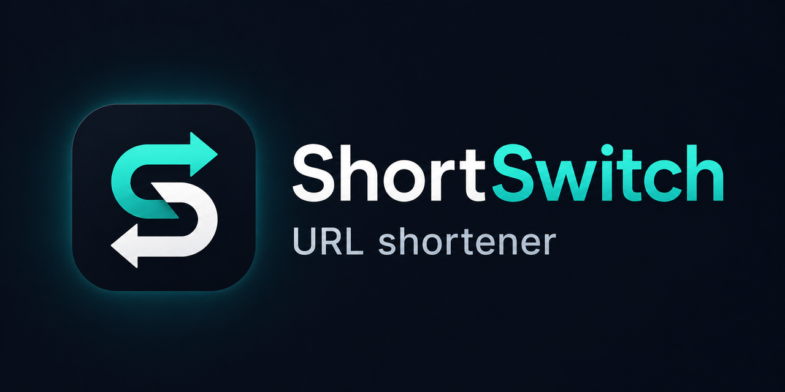

# ShortSwitch

Privacy-aware self-hosted URL shortener with a modern Vue 3 dashboard, interactive Live activities, lightweight public Pages, secure server-side sessions, and analytics.



## Highlights

- Vue 3 + TypeScript + TailwindCSS frontend
- Fastify + TypeScript backend
- SQLite storage with Docker volume persistence
- Responsive mobile-first dashboard
- Light and dark themes
- Password-protected and expiring links
- Live open-answer, word-cloud, multiple-choice and scale activities
- Anonymous or named participation with live SSE result boards
- Global ban filter and manual moderation queue
- Linktree-style public Pages with reusable blocks, themes, preview and independent analytics
- Per-link analytics and global analytics
- Cookie-based authentication with server-side sessions
- Single-container Docker deployment

## Stack

- Frontend: Vue 3, TypeScript, TailwindCSS
- Backend: Fastify, TypeScript
- Database: SQLite
- Deployment: Docker, Docker Compose
- Tests: Vitest

## Features

- Clean dashboard with `Links`, `Live`, `Pages`, `Analytics`, and `Settings`
- Link creation with custom slug, password, and expiration
- QR code generation and download
- Per-link stats:
  - Daily, weekly, and monthly trends
  - Visits, unique visitors, referrers, failed auth attempts
  - Recent click details
- Global analytics:
  - Total clicks, links, referrers, devices
  - Monthly traffic trend
  - Weekly activity heatmap
  - Top referrers, top slugs, languages, device analytics
- Session management and password reset flow
- Single-user admin reset flow for self-hosted recovery
- Presentation mode with direct activity QR codes
- Public Page editor with shared live preview, draft/published/disabled lifecycle and unified root slugs

## Security

ShortSwitch is built around secure defaults for self-hosted use.

- Cookie-based auth with server-side sessions
- `HttpOnly` session cookies
- `SameSite=Lax` by default
- `Secure` cookies supported and recommended for HTTPS
- CSRF protection on authenticated state-changing routes
- Argon2 password hashing for account passwords and protected links
- Session revocation and invalidation after password changes
- CORS allowlist instead of reflective CORS
- Helmet with strict CSP support
- Centralized log redaction for passwords, cookies, auth headers, CSRF tokens, and session identifiers
- Rate limits for login and password-protected links
- Strict slug validation and reserved slug protection
- Safe redirect validation for destination URLs
- Privacy-aware analytics with hashed IP support
- Analytics cleanup retention job

## Privacy Notes

- No JWTs are stored in `localStorage`
- Analytics can run with `STORE_RAW_IP=false` and `IP_HASH_SECRET`
- Analytics failures do not block redirects
- The built-in rate limiter is in-memory and intended for a single-container deployment

## Quick Start

### Local Docker run

```bash
docker compose up --build
```

Open [http://localhost:3000](http://localhost:3000).

### Local development

```bash
npm install
npm run dev
```

## Tests

```bash
npm test
npm run typecheck
npm run build
npm run verify:production
npm run load:live:200
npm run load:live:500
npm run load:live:word-cloud
npm run load:live:open
npm run load:live:history
npm run load:links:50
npm run load:links:200
npm run load:links:500
npm run load:live:50
npm run load:pages:50
npm run load:pages:200
npm run load:pages:500
```

## Branding Assets

Drop branding assets into `public/`:

- `public/icons/favicon-32.png`
- `public/icons/apple-touch-icon.png`
- `public/icons/icon-192.png`
- `public/icons/icon-512.png`
- `public/icons/maskable-512.png`
- `public/og/app-og.png`
- `public/og/app-og-mobile.png`

The runtime manifest and meta tags are generated by the app, so you only need to provide the image assets.

## Docker Configuration

The checked-in [docker-compose.yml](docker-compose.yml) is intentionally a local test stub. It is useful for local validation, but you should edit it before deploying to a public VPS.

Important environment values:

- `APP_NAME`
- `APP_DESCRIPTION`
- `PUBLIC_URL`
- `CORS_ORIGIN`
- `COOKIE_SECURE`
- `ADMIN_EMAIL`
- `ADMIN_PASSWORD`
- `ADMIN_NAME`
- `RESET_ADMIN`
- `STORE_RAW_IP`
- `IP_HASH_SECRET`
- `ENABLE_CSP`

### Admin bootstrap

ShortSwitch follows a single-user self-hosted model.

- If no admin exists, the container creates one from `ADMIN_EMAIL`, `ADMIN_PASSWORD`, and `ADMIN_NAME`
- If `RESET_ADMIN=false`, existing credentials in the database remain in use
- If `RESET_ADMIN=true`, the container force-resets the single admin account from Docker config, revokes active sessions, and keeps the system aligned to one canonical user

Use `RESET_ADMIN=true` only when you intentionally want to recover or rotate the main admin account.

## Production Checklist

Before deploying to a real VPS, update the Docker config:

- Set `PUBLIC_URL` to your external HTTPS URL
- Set `CORS_ORIGIN` to your exact trusted origin
- Set `COOKIE_SECURE=true`
- Replace admin credentials with strong values
- Set a long random `IP_HASH_SECRET`
- Prefer `STORE_RAW_IP=false`
- Keep `ENABLE_CSP=true`
- Keep `RESET_ADMIN=false` for normal operation
- Back up the SQLite volume at `/app/data`

## Known Deployment Notes

- The current checked-in Docker setup is best for local testing first
- SQLite is stored inside the Docker volume mounted at `/app/data`
- The application currently targets a single-container self-hosted deployment

## Project Structure

- `src/client/` - Vue application
- `src/server/` - Fastify server, services, repositories, views
- `src/shared/` - shared TypeScript types
- `docs/LIVE.md` - Live architecture, API, storage, moderation, realtime and load-test guide
- `docs/PAGES.md` - Pages architecture, blocks, API, storage, security and verification guide
- `public/` - branding and OG assets

## License

MIT license.
